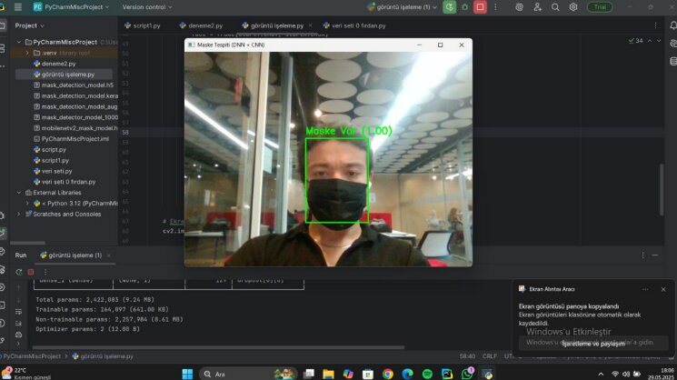
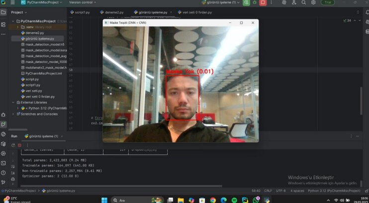

# Real-Time Face Mask Detection

A computer vision & deep learning project for detecting face masks in real time, developed as a course project.

## 📸 Screenshots
<p align="center">
  
  
</p>

## 📁 Contents
- `FINAL_PROJE_RAPOR_GRUP15.ipynb` — Model training, evaluation, and real-time detection notebook
- `FINAL_PROJE_RAPOR_GRUP15.pdf` — Detailed project report

## 🛠️ Tech Stack
- **Language:** Python
- **Environment:** Jupyter Notebook
- **Domain:** Computer Vision / Deep Learning

## 🚀 Getting Started
1. Clone the repository:
   ```bash
   git clone https://github.com/Msdtek/realtime-mask-detection.git
   ```
2. Open `FINAL_PROJE_RAPOR_GRUP15.ipynb` in **Jupyter Notebook** or **Google Colab** and run the cells.